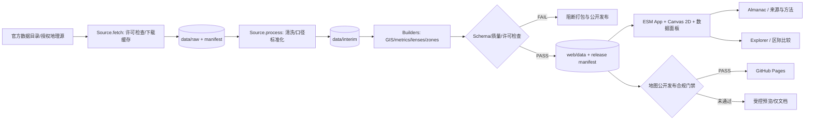

# ShanghaiCiv 技术架构与数据合同草案

> **状态**：Architecture Proposal，尚未实现。数据合同待 P02 冻结；所有示例 JSON 都是 **synthetic contract examples**，不是上海真实统计数据。  
> 关联：[PRD](./PRD.md) · [IMPLEMENTATION_PLAN](./IMPLEMENTATION_PLAN.md) · [DATA_CATALOG](./DATA_CATALOG.md)

## 1. 架构决策摘要

| 维度 | 首选方案 | 备选/限制 |
|---|---|---|
| 页面 | 原生 JS ES Modules + HTML/CSS | 如未来组件复杂再评估框架，不作为 MVP 前提 |
| 绘图 | Canvas 2D + 离屏缓存 | 合法底图服务可能需要独立图层容器/SDK，按条款适配 |
| 几何 | Python 空间预处理 + 浏览器最少计算 | 在地理库/部署复杂度上进行基准测试；不机械照搬美国投影 |
| 数据构建 | Python 3.11+，`uv` 管理环境 | 地理库可采用 pyproj/shapely 等经许可证审核的成熟依赖 |
| 数据交付 | 版本化 JSON + 必要压缩/分片 | 只公开许可允许的数据和衍生物 |
| 来源追溯 | Sources registry + raw manifest + build manifest | SHA-256、许可/统计期、处理方法 |
| 发布 | GitHub Pages | 仅当地图发布及数据再分发合规通过 |
| 测试 | pytest/unittest、JS tests、Playwright | CI fail closed |

### 为什么不直接复制 USACIV 的美国地图处理

- 美国本土与上海城市级投影、地形分辨率和行政边界授权条件不同；
- 中国地图可能涉及依法审核和审图号要求，不能因为是 Canvas 自绘就跳过；
- 大部分公开统计数据只有市/区尺度，六边形**只用于地理索引**而非制造微观观测；
- P02 应基于上海合法可用数据和性能评估确定最终 CRS、网格及内存格式。

## 2. 总体数据流



### 建议目录（P00/P02 实施后落地）

```text
ShanghaiCiv/
├── README.md
├── AGENTS.md
├── pyproject.toml
├── pipeline/
│   ├── __main__.py              # list/fetch/process/build/check/all/serve
│   ├── core/
│   │   ├── source.py            # Source, SourceInfo, license gate
│   │   ├── fetch.py             # download/cache/retry
│   │   ├── geo.py               # CRS, projection, boundaries
│   │   ├── hexgrid.py           # odd-r, neighbour, cell_at
│   │   └── store.py             # atomic IO, deterministic JSON
│   ├── sources/                 # 每个发布机构/数据集单独 adapter
│   ├── build/                   # dependency declared builders
│   └── check.py
├── data/
│   ├── catalog/                 # source/metric registry（可公开元数据）
│   ├── raw/                     # gitignored，遵守第三方许可
│   ├── interim/                 # gitignored，可能包含受限数据
│   └── reports/
├── schemas/
│   ├── source.schema.json
│   ├── world.schema.json
│   ├── district.schema.json
│   ├── metric.schema.json
│   └── lens.schema.json
├── web/
│   ├── index.html
│   ├── css/
│   ├── data/                    # 仅许可可发布的构建产物
│   ├── js/
│   │   ├── main.js
│   │   ├── camera.js
│   │   ├── hex.js
│   │   ├── render/{map,overlay,art}/
│   │   ├── ui/{district,lens,almanac}/
│   │   ├── app/{api,search,urlstate}/
│   │   └── ext/{zones,explorer}/
│   └── dev/art.html
├── docs/
│   ├── PRD.md
│   ├── IMPLEMENTATION_PLAN.md
│   ├── DATA_CATALOG.md
│   ├── ARCHITECTURE.md
│   ├── ACCEPTANCE.md
│   ├── DECISIONS.md
│   ├── DATA_CONTRACTS.md        # P02 具体锁定
│   ├── research/
│   ├── compliance/
│   └── release/
└── tests/{unit,integration,e2e,fixtures}/
```

## 3. 数据合同 v0（P02 待确认）

### 3.1 标准来源记录

```json
{
  "source_id": "SRC-EXAMPLE",
  "publisher": "示例机构",
  "title": "仅供合同测试的示例数据",
  "homepage": "https://example.invalid/",
  "dataset_url": null,
  "retrieved_at": null,
  "reference_period": "2024",
  "license_status": "unknown",
  "redistribution_allowed": null,
  "sha256": null,
  "status": "metadata_reviewed",
  "notes": "synthetic example; not a publishable source"
}
```

### 3.2 行政区实体（不在本例给出真实编码/数据）

```json
{
  "schema_version": 1,
  "districts": [
    {
      "id": "district-example",
      "name_zh": "示例区（虚构，不应发布）",
      "adcode": null,
      "geometry_ref": null,
      "geometry_license_status": "unknown",
      "region_type": "district"
    }
  ]
}
```

### 3.3 指标记录

```json
{
  "metric_id": "population_resident",
  "geography_id": "district-example",
  "granularity": "district",
  "value": null,
  "unit": "person",
  "period": "2024-12-31",
  "status": "unavailable",
  "source_id": "SRC-EXAMPLE",
  "method_id": null,
  "quality_flags": ["synthetic"]
}
```

数据字典要求：

- 观测值类型：`observed` / `derived` / `estimated` / `unavailable`；不可用必须 `value: null`；
- 市/区/街镇/格网属不同实体，不能把 `granularity=district` 的 value 替换成 `hex`；
- GDP 保留价格口径（现价/不变价）和数据修订说明；
- 版本：`schema_version` 与数据时期 (`reference_period`) 分离；
- 经纬度/米制平面坐标禁止无说明混用。

### 3.4 地理世界与网格合同（待 P04 实装）

```json
{
  "schema_version": 1,
  "projection": {
    "id": "PENDING_CRS_SELECTION",
    "units": "metre",
    "source_crs": null,
    "origin_xy": null
  },
  "grid": {
    "layout": "odd-r",
    "orientation": "pointy",
    "radius_m": 1000,
    "cols": null,
    "rows": null
  },
  "cells": [],
  "geometry_data_license_status": "unknown"
}
```

该 JSON 是**结构草案**。最终可使用数组压缩以降低体积，但字段意义不变，`cells` 是否允许随发布包提供需以许可核对为准。

## 4. GIS 空间规则

### 4.1 坐标流

```text
original_geometry + source_crs
    ↓ inspect / validate
reprojection (approved local metric CRS)
    ↓
canonical_map_xy (metre, origin and axis documented)
    ↓
hexgrid index / district lookup / facility placement
    ↓
browser camera pixel transform
```

- 不将 GCJ-02、BD-09、WGS84、CGCS2000 视为同一坐标；
- 界线拼接时记录源法定标准、几何完整性和坐标单位；
- 正式上线之前由 GIS 审核地图对齐情况；
- 以行政区实体做统计单元，格网主要用于地形/点击/设施空间查询。

### 4.2 六边形坐标

对候选尖顶六边形（`odd-r`）：

```text
x = sqrt(3) * R * (col + 0.5 * (row mod 2))
y = 1.5 * R * row
index = row * cols + col
```

- 实现 O(1) 从格网 ID 到中心与邻居；
- coordinate→cell 按 cube rounding 实现并跨 Python/JS 共享 fixtures；
- 边界格用覆盖比例或 partial 标记，不以「最近中心点」捏造某区行政占有范围；
- 对坐标系不一致、数值 NaN/out-of-bounds、负索引做强校验。

## 5. 处理流水线的模块合同

建议 `Source` 只关心下载与整理：

```python
class Source:
    info: SourceInfo
    def fetch(self, *, force: bool = False) -> None: ...
    def process(self) -> dict: ...
```

Builder 负责融合，声明 `REQUIRES`、`PRODUCES`、`build()`，按照依赖图排序；每个 builder 可以实现 `check(web_dir)` 返回 `PASS/NOTE/WARN/FAIL`。任何 `FAIL` 退出非 0。

**原则**：来源适配器不能直接依赖浏览器 UI；渲染模块不能负责清洗统计口径；每项汇总数字使用 metadata 中的 method 解释计算逻辑。

## 6. 浏览器分层与交互 API

**地图渲染**：
1. 初始加载 world/geometry 元数据和少量经济摘要；
2. 静态层缓存水陆、格网、地图艺术、行政面；
3. 动态层绘制悬停/选中/搜索高亮；
4. 通过视窗裁剪与多级 LOD 降低绘图负担；
5. 明细表/POI/高级图层按需加载数据。

**模块 API（建议）**：

```javascript
app.registerStaticLayer({ id, z, draw, visible });
app.registerOverlay({ id, z, draw });
app.registerMode({ id, open, close });
app.loadData("district_metrics");
app.setHighlight({ districts: ["example"] });
app.ui.dock({ id: "district-details", element });
```

**状态管理**：`camera`、`selectedDistrict`、`selectedZone`、`lens`、`visibleLayers`、`hover`。通过受控事件 API 同步面板和地图，URL 仅存公开可分享的地图视角。

**截图/分享**：基于已渲染层合成，无权利声明无法确认的第三方瓦片不可擅自导出再分发；必要时关闭导图功能。

## 7. 扩展与性能预算

- LOD 至少四档：远景重整体、近景重地物；在密集中心城区增加标签避让；
- 静态层仅在相机停稳/参数变化时重绘，动态层按需要绘制；
- sprites 使用确定性种子及有界 LRU 缓存；
- 根据 `performance.mark` / 人工基准记录首屏、交互、帧时、内存；
- 数据包初始预算 ≤15 MB，扩展图层懒加载；超预算需解释分块策略；
- 设备与浏览器版本见 `docs/ACCEPTANCE.md`，预算不代表当前测量结果。

## 8. 测试与发布

**测试金字塔**：数值/格网单测 → 来源与 builder 集成 → 端到端地图交互 → 合规/人工空间核验。

**禁止自动公开情形**：
- 源 `license_status` 未允许或 `redistribution_allowed` 未确认，且实际部署需再分发；
- 第三方底图/内容不能合法公开或审图义务未完成；
- 统计数据无来源/单位/时期；
- 几何与区划不匹配；
- 构建质量有 FAIL，或 secrets scan 不通过。

部署 workflow 应只处理审核过的数据构建产物；公开 GitHub 仓库与 GitHub Pages 是两个不同的授权决策，不能因为代码开源就自动开源原始地理数据。

## 9. 原版参考与上海差异

- [USACIV 源码 ZIP](https://karpathy.ai/usaciv/usaciv-source.zip)
- [USACIV 站点](https://karpathy.ai/usaciv/)
- [上海统计年鉴](https://tjj.sh.gov.cn/tjnj/)
- [天地图·上海](https://shanghai.tianditu.gov.cn/)

**上海项目优先复用思想**：可插拔 Sources、builder DAG、数据合同、Almanac、Canvas LOD 和结构化质量检查；**不直接沿用**：美国 Albers 参数、25 km 半径、美国 Census/BEA 指标映射、美国界线/地图素材的使用假设。