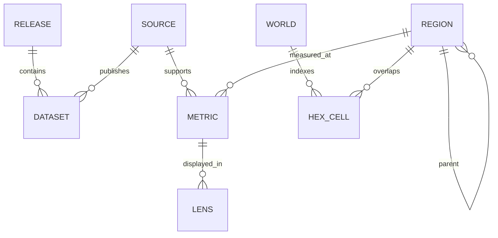

# ShanghaiCiv 数据合同 v1（P02）

> **实施状态**：Contract v1 synthetic baseline（2026-11-27）  
> **不是正式地理数据发布许可**。P01 G1 仍然 BLOCKED，P02 只能运行虚构本地网格与统计 fixture。  
> 文档入口：[PRD](./PRD.md) · [阶段计划](./IMPLEMENTATION_PLAN.md) · [原始统计研究](./research/FEASIBILITY_REPORT.md) · [合规审核](./compliance/MAP_PUBLICATION_CHECKLIST.md)。

## 0. 合同目标及权威范围

本合同由 `schemas/*.schema.json` 的 JSON Schema 2020-12 形状描述 + `pipeline/contracts.py` 和 `web/js/contracts.mjs` 的交叉引用与统计语义校验组成；各方以同一标准数据包为输入。

**每个展示值必须可回答：什么指标、哪个统计单元、什么年份、什么单位、观察值还是模型值、来自哪个合法来源、如何计算。**

### v1 约束

- 值为 `number` 或 `null`；未知/缺失使用 `null`，不是 0；
- `source_id` 通过 source registry 解析；`geography_id` 必须指向明确实体；
- `status` 严格为 `observed` / `derived` / `estimated` / `unavailable`；
- 统计区划、专题图与六边形网格是**不同的数据层**；
- `schema_version` 与 `data_vintage` 分离；一个版本可包含不同 period，但不同 period 不默认可比；
- 来源的 `native_granularity` 表示原生测量尺度；仅允许 `observed` 在一致空间尺度声明，不能将区级观测宣称为真实格网级；
- 允许构造派生/估计指标，但必须有 `method_id`；估计值 `quality_flags` 必含 `modeled`；
- `release.synthetic=true` 表示全包都是**虚构测试数据**；禁止将此包 `publish_approved=true`；
- `publish_approved=true` 也只表示通过了自动前置数据门禁，不代替真实地图授权、版权和主管部门审核；仍须人工签署 G1/G6。

## 1. 实体、关联与稳定标识



此图中的 `DATASET`、`HEX_CELL` 是领域概念；v1 测试 bundle 为降低复杂度把 dataset 版本元信息归入 source 与 release，而 grid cell 通过 `cell_id` 存在于 `world.memberships`。P03 引入实际的 dataset registry 时需补充 dataset schema，不应暗中改变 v1。

| 实体 | 主键策略 | 示例（均为 synthetic） | 说明 |
|---|---|---|---|
| municipality | `region.id` 全局唯一 | `synthetic-city` | 单个父行政实体 |
| district | `region.id` 全局唯一 | `synthetic-district-a` | 真实场景映射至官方 6 位区划代码；区域名**不是** ID |
| zone | `region.id` 全局唯一 | `synthetic-zone-1` | 同名不同园区可共存；空间范围可能无法准确获得 |
| hex_cell | `hex:<cell_id>` | `hex:0` | 仅作为统一格网 ID，依赖具体 `world.grid` |
| facility | `region.id` 全局唯一 | `synthetic-facility-a` | 未来与 point/line 数据及许可关联 |
| source | `source.id` | `SYN-001` | 发布者 + 精确出处/许可状态 |
| metric | `(metric_id, geography_id, period)` | `population, synthetic-district-a, 2024` | 唯一统计观察键 |
| lens | `lens.id` | `lens-population` | 将已定义的指标可视化，不创造新数值 |
| release | `release.build_id` | `synthetic-2024-p02` | 构建版本，记录 data_vintage 及许可签署状态 |

生产区级数据正式 ID 最终应绑定官方区划代码与适用年份；**不能把 2026 年区划代码当作 2024 年街镇边界证明**。

## 2. 文件合同与 JSON Schema

| 文件 | JSON Schema | 生产意义 |
|---|---|---|
| `source.json` | [source.schema.json](../schemas/source.schema.json) | 数据发行方、原生空间粒度、授权与再分发标记 |
| `region.json` | [region.schema.json](../schemas/region.schema.json) | 行政区/园区/设施，名称与主键分离 |
| `metric.json` | [metric.schema.json](../schemas/metric.schema.json) | 观测值、派生值、估算与缺失 |
| `lens.json` | [lens.schema.json](../schemas/lens.schema.json) | 专题图声明，按真实统计粒度着色 |
| `world.json` | [world.schema.json](../schemas/world.schema.json) | 米制平面坐标系、odd-r 网格、格网行政区覆盖比例 |
| `release.json` | [release.schema.json](../schemas/release.schema.json) | 版本、是否 synthetic、许可门禁 |
| `bundle.json` | [bundle.schema.json](../schemas/bundle.schema.json) | 合同测试/交换用完整对象 |

所有规范化产物使用 UTF-8、稳定排序和有限数字；版本不兼容必须提升 `schema_version`。额外未知字段在 JSON Schema 下会被拒绝，扩展字段先更新 Schema、Python 校验、JavaScript 校验和 fixture。

### 正式统计字段

```json
{
  "metric_id": "population",
  "geography_id": "synthetic-district-a",
  "granularity": "district",
  "value": 100000,
  "unit": "persons",
  "period": "2024",
  "status": "observed",
  "source_id": "SYN-001",
  "method_id": null,
  "quality_flags": ["synthetic_fixture"]
}
```

**此处100000是虚构测试数字，绝非上海真实统计值。** source 必须给出 `native_granularity`，上述 `observed` 仅适用于 district。来源原始粒度为 district 时，即使把 `geography_id` 写成 `hex:0`，语义验证器也会报 `METRIC_NATIVE_GRANULARITY`；观测状态下还需 `direct_spatial_observation` 标志才能合法表达格网级来源。

### 数据状态约束

| 状态 | value | method_id | quality_flags | 含义 |
|---|---|---|---|---|
| observed | 有限数字，可为真实 0 | 通常 null | 可选 | 来源直接报告的观测或正式统计值 |
| derived | 有限数字 | 必须有 | 推荐计算口径 | 由已核实输入值计算 |
| estimated | 有限数字 | 必须有 | 必须含 `modeled` | 模型/插值推断，不能伪装官方观测 |
| unavailable | 必须 null | 可 null | 推荐 `missing_value` | 不知道/无数据，不参加排名 |

**被拒绝的假精度例子**：某区报告人口 100 万，把这个数平均写进 200 个 hex 并标记 `observed`；这仍是区级值，不是格网级测量，应在聚合层面明确标示估算过程和误差，禁止直接改写源数据粒度。

## 3. 坐标系统与空间单位

- 真实数据：`raw_crs` 和坐标来源在 P03/P04 登记；上海正式米制 CRS 仍为 D-004 未决，不能沿用美国 Albers 参数。
- Synthetic fixture：`projection.crs="SYNTHETIC_LOCAL_METERS"`，是任意数学平面，不对应真实上海经纬度。
- 正规化坐标：地图单位为 **metre**，x 向右、y 向下；`projection.origin_x_m/origin_y_m` 用于投影空间范围声明。
- 格网：`grid.layout="odd-r"`，`orientation="pointy"`，`radius_m=1000` 目前仅候选；`grid.origin_x_m/origin_y_m` 定义网格坐标原点。
- `grid.cols`、`grid.rows` 为正整数；`cell_id=row*cols+col`，行列均零基；格内映射可 O(1)。
- `world.memberships` 仅表达几何/区属**覆盖比例**，每条记录的 `fraction` 在 (0,1]，同一 cell 中不同 district 占比合计不得超过 1（允许 1e-6 容差）。
- 网格边界处的部分覆盖 `fraction<1` 不可推断为按占比分配该区人口/GDP 的可靠估算；统计层仍显示 district 值。

示例六边形中心公式（`R` 为半径，`col,row` 为整数）：

```text
x = origin_x_m + sqrt(3)*R*(col + 0.5*(row & 1))
y = origin_y_m + 1.5*R*row
index = row*cols + col
```

映射函数 `cell_at(x,y)` 用 axial/cube rounding 找最近中心点；只有索引意义，不是法定行政边界。Python `HexGrid` 与 JavaScript `HexGrid` 使用相同邻接顺序 E, SE, SW, W, NW, NE。

## 4. 数据一致性与地图渲染合同

### 4.1 前端不可自行推断统计

- Canvas 和 UI 直接消费 `metrics` 和 `lenses`；不得根据行政区面几何把人口和 GDP 分摊至格网当「观测」；
- `lens.granularity="district"` 时，专题色块必须覆盖行政区/适当合法范围，而非将每个 hex 填成伪精度的独立值；
- `lens.metric_id` 应指向至少一个同粒度的 metric；指标缺失显示中性色，并计入缺失率；
- 稳定 ID 驱动点击和搜索；同名的 Zone 必须按 ID 区分；
- 需要显示跨期序列时，必须先判断相同 metric_id/单位/时期/空间粒度以及测量状态。`comparable(a,b)` 是**同一统计期直接排名**判定，合法跨期分析需单独定义修订、价格和行政区边界调整规则。

### 4.2 数字格式与修订

- 金额建议以整数或明确小数的“元/亿元”统一单位，保留原始统计表单位及转换方法；
- 不混用当年价 GDP 和不变价 GDP；数据版本与统计期不同；
- 来源表行政面积字段不能直接当作 hex land surface 面积；
- 上海2024 GDP 存在初核和最终核实修订，生产设计需要单独 `revision_stage`；P02 v1 仅以质量标记说明，P03 扩展时需先升级合同。

## 5. Source/Release 权限门禁

来源包含 `license_status`：`unknown`、`allowed`、`restricted`、`prohibited`、`synthetic`，以及 `redistribution_allowed` 布尔或 null。

- synthetic bundle 的 source 必须全部是 synthetic；其 `publish_approved` 永远是 false；
- 任何生产 bundle 若 `publish_approved=true`，全部来源必须 `license_status=allowed` 且 `redistribution_allowed=true`，`license_review=approved`；
- **自动许可字段并非法律授权证明**，这些字段必须由合规负责人对已核查的实际条款/授权证据进行签署；
- 公开地图仍须独立核查区界、底图与审图/标注事项；本合同门禁不取代合规审查。

## 6. 两套只读合成 fixture

| 文件 | 目的 |
|---|---|
| [synthetic_2024.json](../tests/fixtures/synthetic/synthetic_2024.json) | 5×4 小型格网、2 个虚构区、同名不同 ID 园区、observed/derived/estimated/unavailable、边界覆盖比例 |
| [synthetic_2025.json](../tests/fixtures/synthetic/synthetic_2025.json) | 第二统计期、缺失区值和不同覆盖比例；检查年份不可默认混比较 |

**全部地名和数字均为虚构；不能在地图 UI 中将 fixture 按真实上海数据展示。** 源 `https://example.invalid/synthetic` 故意不可访问。

### 验证命令

```bash
# 1. 仅 stdlib 的跨记录语义检查
python -m scripts.validate_p02_contracts

# 2. Node ESM 语义检查（同样结果）
node scripts/validate_p02_contracts.mjs

# 3. Python 语义、Python↔JS 一致性与格网单测
python -m unittest discover -s tests -v

# 4. JS 自测
node --test tests/js/*.test.mjs

# 5. 完整 JSON Schema 2020-12 形状约束测试
python -m pip install -r requirements-test.txt
python -m unittest tests.test_contracts -v
```

Python tests 中跨运行时案例调用 Node 并比对错误码；JSON Schema 结构检查使用 `jsonschema` 及引用注册表。GitHub Actions 重跑全部步骤；测试报告必须注明实际完成与未运行情况。

## 7. 质量错误码（部分）

| 错误码 | 触发原因 | 发布影响 |
|---|---|---|
| `METRIC_SOURCE_REF` | 指标引用不存在的 source | FAIL |
| `METRIC_PERIOD` | 缺少/格式错误统计期 | FAIL |
| `METRIC_GEO_REF` | 地理实体不存在/错误类型 | FAIL |
| `METRIC_NATIVE_GRANULARITY` | 原生区级观测伪装成 hex 观测 | FAIL |
| `METRIC_HEX_OBSERVATION` | hex 观测缺直接空间测量标记 | FAIL |
| `METRIC_STATUS_VALUE` | 缺失用 0 或观测使用 null | FAIL |
| `METRIC_DERIVATION` | 派生/估计方法缺失 | FAIL |
| `METRIC_ESTIMATE_FLAG` | 模型估计缺明确标记 | FAIL |
| `MEMBERSHIP_SUM` | 同一单元行政区覆盖比例 > 100% | FAIL |
| `REGION_DUPLICATE` | 复用同一实体 ID | FAIL |
| `SYNTHETIC_REAL_SOURCE_MIX` | 真实来源混入测试包，或反之 | FAIL |
| `RELEASE_SYNTHETIC_PUBLISH` | 将合成 fixture 作为生产批准 | FAIL |
| `SOURCE_RELEASE` | 发布包引用未获许可/未允许再分发的源 | FAIL |

## 8. v1 边界与 P03/P04 接口

**P02 的实现仅到可信数据模型、语义验证、合成格网与自动化测试**。没有真实官方地图几何、没有实际 ETL、没有生产网站和地图发布，不应声称地图可用。

在 P03 前应补齐 dataset/source 实际许可记录与 `revision_stage`，在 P04 前应确定上海正式 CRS、实际合法几何来源、地表分类和合法底图叠加路径。以上需提交新的 ADR 及合同版本变更，不可直接塞入已有 fixture 冒充上海地理。

**冻结条件**：Schema 与 Python/JS 校验通过、两套 synthetic fixtures 同通过、非法来源/年份/空间粒度/发布状态反例均 FAIL、GitHub Actions CI 成功，才可将 P02/G2 视为工程层面的完成。