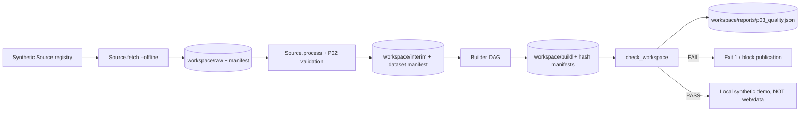

# ShanghaiCiv P03｜可复现数据源 ETL 流水线

> **阶段**：P03 / Data Engineering · **状态**：代码已提交，验收以 CI 实际结果为准  
> **数据范围**：**只处理合成数据**；真实官方统计研究数据及上海 GIS/POI 未被下载或发布  
> **依赖**：[P02 数据合同](DATA_CONTRACTS.md) · [P01 许可阻塞](compliance/MAP_PUBLICATION_CHECKLIST.md) · [Issue #7](https://github.com/1998x-stack/ShanghaiCiv/issues/7)

## 1. 核心架构



P03 **不把** `data/research/districts_2024_observations.json`（2024 上海16区研究数字）当作已许可源，不直接从天地图提取任何行政区 geometry。这里的 `synthetic_2024` 和 `synthetic_2025` 完全虚构，主要用于测试。

### 模块分工

| 文件 | 责任 | 防护 |
|---|---|---|
| `pipeline/core/source.py` | `SourceInfo` 和抽象 `Source.fetch/process` | 源是否允许读取与发布的显式检查 |
| `pipeline/core/fetch.py` | 可选 HTTP 下载、重试、缓存、原子写入 | 默认禁止网络；要求来源 allowed、HTTPS；**没有真实数据适配器** |
| `pipeline/core/store.py` | SHA256、稳定 JSON、atomic write | 避免部分文件与同一输入不同序列化 |
| `pipeline/sources/synthetic.py` | 两种虚构年度数据的本地适配器 | 禁止在线模式；cache 校验与 force 修复 |
| `pipeline/build/graph.py` | Builder `requires/produces` 拓扑依赖 | 拒绝重复产物、循环与缺依赖 |
| `pipeline/build/bundles.py` | 2024/2025 合成 bundle + 版本 index | `publish_approved=false` 强制检查 |
| `pipeline/check.py` | raw→interim→bundle 来源 hash 链及语义 | 所有 FAIL 阻断，生成 quality report |
| `pipeline/__main__.py` | list/fetch/process/build/check/all | 默认离线；可指定完全隔离 workspace |
| `schemas/dataset.schema.json` | 归一化数据集元信息合同 | version、source、reference period、revision、SHA256 |

## 2. 运行方式

项目根目录执行：

```bash
# 只列出两个合成源
python -m pipeline list

# 端到端离线构建；不会访问真实互联网数据源
python -m pipeline all --offline --workspace .p03-work

# 分阶段运行
python -m pipeline fetch --offline --workspace .p03-work
python -m pipeline process --workspace .p03-work
python -m pipeline build --workspace .p03-work
python -m pipeline check --workspace .p03-work

# 修复/刷新本地合成缓存；仍不会联网
python -m pipeline fetch --offline --force --workspace .p03-work

# 自动化测试（需 Python 3.11+）
python -m pip install -r requirements-test.txt
python -m unittest discover -s tests -v
node --test tests/js/*.test.mjs
```

**工作目录** `.p03-work/` 被 Git 忽略，内部结构为：

```text
.p03-work/
├─ raw/
│  ├─ synthetic_2024.json
│  ├─ synthetic_2024.manifest.json
│  ├─ synthetic_2025.json
│  └─ synthetic_2025.manifest.json
├─ interim/
│  ├─ synthetic_2024.json
│  ├─ synthetic_2024.manifest.json
│  ├─ synthetic_2025.json
│  └─ synthetic_2025.manifest.json
├─ build/
│  ├─ bundle_2024.json
│  ├─ bundle_2024.manifest.json
│  ├─ bundle_2025.json
│  ├─ bundle_2025.manifest.json
│  └─ index.json
└─ reports/
   └─ p03_quality.json
```

所有文件使用固定排序的 JSON 序列化；合成源不记录虚构的抓取时间（`retrieved_at=null`），相同输入重复构建应得到**字节一致**的 raw/interim/build/manifest/report。

## 3. 许可、数据年份与来源链

真实来源准入：

- `SourceInfo.license_status` 必须为 `allowed` 才可能使用 HTTP 获取；`unknown/restricted/prohibited` 默认阻断；
- HTTP 下载须明确传入 `offline=False` 且 URL 为 HTTPS；P03 CLI 只注册合成源，不提供真实数据在线模式；
- 对于正式公开分发还需要 `redistribution_allowed=True`，此技术字段不是授权证明，必须关联真实条款/书面许可；
- 研究阶段官方年鉴的数据使用权、GIS 区界/地图 API 和地图发布审核仍在 [#3](https://github.com/1998x-stack/ShanghaiCiv/issues/3)、[#4](https://github.com/1998x-stack/ShanghaiCiv/issues/4)、[#5](https://github.com/1998x-stack/ShanghaiCiv/issues/5) 等待外部核验；
- 构建器强制合成 `release.synthetic=true` 且 `publish_approved=false`；输出仅在隔离 workspace 下，不复制到 `web/data/`；
- 16区研究中工业总产值 1,717.14 亿元未解释差额保持 **NOTE / 未解决**，不把错误修正塞入本地合成 ETL。

### Manifest 基准字段

Raw 阶段：`source_id/source_url/reference_period/sha256/bytes/retrieved_at/license_status/redistribution_allowed/native_granularity/stage/synthetic`。

Interim 阶段：`dataset_id/source_id/reference_period/revision_stage/source_sha256/sha256/bytes/native_granularity/license_status/redistribution_allowed/method`。

Build 阶段：`dataset_id/source_id/source_sha256/interim_sha256/output_sha256/bytes/synthetic/publish_approved`。

版本元信息已加入 [dataset.schema.json](../schemas/dataset.schema.json)。新增真实源时要校验 schema、记录下载/引用证据并升级 review；不能把 P03 fixture 视为可直接替换的数据样本。

## 4. 质量验收计划

| 测试 ID | 内容 | 通过要求 |
|---|---|---|
| T-P03-01 | 完整构建两次 | 全部 JSON 文件哈希逐一相同 |
| T-P03-02 | 缓存命中 | 合法原缓存不被重新下载或重写 |
| T-P03-03 | 缓存损坏 | SHA256 mismatch → FAIL；`--force` 明确修复 |
| T-P03-04 | 处理中间产物损坏 | check FAIL，重建后恢复 |
| T-P03-05 | Builder DAG | 缺依赖、循环或重复输出 → FAIL |
| T-P03-06 | 未授权网络访问 | source unknown 即使请求 online 也阻断 |
| T-P03-07 | 离线禁止 HTTP | 无网络访问许可，`offline=True` 立即拒绝 |
| T-P03-08 | 来源与数据版本 | 2024/2025 来源 chain、metric periods 保留 |
| T-P03-09 | 发布数据隔离 | `web/data` 不出现真实 GIS 或研究 JSON |
| T-P03-10 | 全局 P02 回归 | Python/JS 统计语义与格网测试继续 PASS |

**外部门禁 G1 仍然 BLOCKED**。P03/G3 的 ENGINEERING 通过只能证明离线 ETL 与许可防护具备基础功能，不意味着已完成真实数据源接入、真实地图或合法对公网发布。

## 5. 已知限制及后续范围

- 当前仅对两套 synthetic fixture 做标准化，**不提供生产统计数据适配器**；官方 HTML/CSV/Excel 数据源须在明确许可后单独引入。
- HTTP engine 为基础能力，不代表已经访问或验证在线官方 API；实际大型数据集的限流、断点续传和凭证管理尚未完成。
- P04 真实上海投影、行政区几何、合法地图展示方案仍为独立任务，不由 P03 的合成地理数据“代替”。
- 在 GIS/数据许可未解决之前，可以继续优化 schema、Source 与 Builder 结构，但对外只能展示明确标注虚构的技术原型。

## 6. 完成定义

当 CI 中 Python、Node、Schema 2020-12、G3 研究隔离、两次构建字节一致和所有异常失败测试实际通过，形成 [P03 验收记录](release/P03_G3_ACCEPTANCE.md) 后，可以将本工程阶段记为「synthetic ETL baseline PASS」；真实源/地图发布仍独立 BLOCKED。