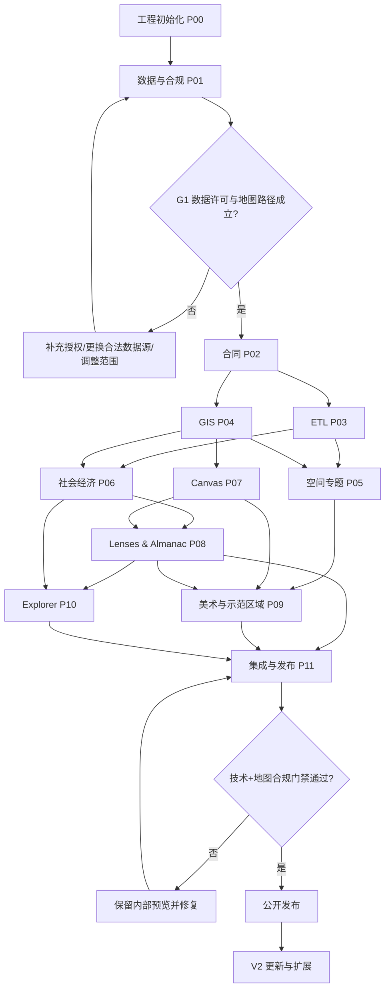

# ShanghaiCiv 分阶段实施计划（Delivery Plan / WBS）

> **版本** v1.0 · **状态** Planned · **起点** 仓库初始化后，产品尚未完成数据/地图合规验证  
> 主需求：[PRD](./PRD.md) · 数据登记：[DATA_CATALOG](./DATA_CATALOG.md) · 结构：[ARCHITECTURE](./ARCHITECTURE.md) · 验收：[ACCEPTANCE](./ACCEPTANCE.md)

## A. 执行约定

本文件是开发工作分解结构（WBS），不是「阶段标题列表」。每项都有 ID、输入、动作和可以检验的输出。执行顺序为 **先盘点→先确认数据授权/地图合规→冻结合同→再实现→验证后公开**。除另行记录的阻塞项外，阶段可以重叠开发，但 **任何公开地图上线不得绕过 G1/G6 合规门禁**。

### A.1 角色（可由同一开发者/多个 Agent 担任）

| 缩写 | 角色 | 最终责任 |
|---|---|---|
| PO | Product Owner | 需求与验收优先级 |
| RE | Research / Data Steward | 数据真实性、来源和许可证证据 |
| GIS | Geospatial Engineer | 投影、拓扑、格网、地理精准度 |
| DE | Data Engineer | ETL、缓存、数据合同与质量 |
| FE | Frontend / Graphics Engineer | Canvas、UI、交互、性能 |
| QA | Quality Engineer | 自动测试、浏览器验收与回归 |
| COM | Compliance reviewer（具备适当职责/资格者） | 地图数据合法性、审图/公示、知识产权检查 |

### A.2 每个任务的 Definition of Done（DoD）

- 有 GitHub Issue 或 PR 描述、关联需求 ID、输入数据版本和输出文件；
- 提交代码、文档与最少一项可执行测试或可审阅证据；
- 新增数据具有来源、URL、统计期、空间粒度、授权记录；没有许可的文件不能进 `web/data`；
- 新增数据结构写入 `DATA_CONTRACTS.md` 并有正反向兼容/版本说明；
- CI 数据检查不出现 `FAIL`，重要 `WARN` 需 owner 明确处置；
- 有截图或录屏的人工可见性核验（地图交互 PR 适用）；
- 通过评审后合并，不能以「AI 已经运行了」替代验收。

### A.3 阶段对照表

| 阶段 | 建议 PR 名称 | 依赖 | 负责人 | 门禁 |
|---|---|---|---|---|
| P00 仓库工程治理 | `chore/project-foundation` | 无 | PO/QA | G0 |
| P01 数据/地图许可调查 | `research/source-and-map-compliance` | P00 | RE/COM | G1 |
| P02 概念模型与数据合同 | `docs/data-contracts` | P01 初步可行 | DE/GIS | G2 |
| P03 采集与标准化流水线 | `feat/source-etl` | P02 | DE | G3 |
| P04 行政区与六边形地理核心 | `feat/spatial-world` | P02、授权几何 | GIS | G4 |
| P05 自然底图与设施空间层 | `feat/terrain-infrastructure` | P03、P04 | GIS/DE | G4 |
| P06 人口与经济专题构建 | `feat/district-economy` | P03、P04 | DE/RE | G3/G4 |
| P07 浏览器基础地图及导航 | `feat/canvas-map-shell` | P04 | FE | G5 |
| P08 专题、来源百科与面板 | `feat/lenses-almanac` | P06、P07 | FE/DE | G5 |
| P09 游戏美术与四个示范区域 | `feat/art-and-zones` | P05、P07、P08 | FE/RE | G5 |
| P10 Explorer 与比较分析 | `feat/explorer` | P06、P08 | FE/DE | G5 |
| P11 集成测试与公开发布 | `release/mvp` | P00-P10 必需项 | QA/COM/PO | G6 |
| P12 持续更新与 V2 扩展（可选） | `feat/refresh-and-advanced` | P11 | 全体 | G7 |

**重要**：PR 名为建议，不代表已经创建；阶段是否包含 P1/P2 功能按 PRD 版本范围决策，MVP 可不等待 P09 全部美术和 P10 高级 Explorer。

---

## P00｜项目初始化与工程基线

**目标**：仓库可以被任何开发者/Agent 克隆、测试、理解和贡献。**投入级别**：S（估算 1–2 工程日，不含外部审批）。**负责人**：PO + QA。

### 工作包

- [ ] **P00-T01** 确认目录结构（`pipeline/{core,sources,build}`、`web/{js,data}`、`docs/`、`tests/`、`scripts/`）和 Python/JS 版本约束；不预先引入无必要的大型框架。
- [ ] **P00-T02** 创建 `README.md`、`CONTRIBUTING.md`、`AGENTS.md`、`docs/DECISIONS.md`；写明不可伪造来源、不可越过合规门禁等 Agent 规则。
- [ ] **P00-T03** 选择 `uv` + Python 3.11+；制定 JS ESM 和 lint/test 命令。
- [ ] **P00-T04** 配置 GitHub Actions：文档/链接检查、Python 单测、JS 合同一致性、密钥与异常大文件检测；不得直接自动公开未核验的地图。
- [ ] **P00-T05** 建立标签（`phase:*`、`type:*`、`priority:*`、`blocked:license`、`blocked:data`）及 PR 模板：范围/数据来源/测试/截图/风险。
- [ ] **P00-T06** 制定分支和合并约定：单 PR 单目标；必须有测试/人工验收；高风险数据和地理改动要求双人复核（若团队允许）。

**交付文件**：`README.md`、`AGENTS.md`、`CONTRIBUTING.md`、`.github/workflows/ci.yml`、`.github/pull_request_template.md`、`pyproject.toml`、空/示例 `tests/`。

**验收**：全新 clone 后文档命令可跑；CI PASS；没有生产地图发布任务；安装命令不依赖本地私人配置。**阻塞**：无。

---

## P01｜数据可得性、来源许可与地图发布预审

**目标**：最重要的可行性门槛；调查而不是直接写抓取脚本。**投入级别**：L（约 3–7 工程日 + 可能的外部审查时间，不承诺审批工期）。**负责人**：RE + COM。

### 工作包

- [ ] **P01-T01** 梳理最小必需实体：上海市、16区、主要水域、可搜索区域点；列出每项需要的公开源、地理粒度与数据年份。
- [ ] **P01-T02** 查询天地图·上海开发文档、服务条款、API 申请/Token/署名、离线缓存限制、是否允许 Canvas 叠加自绘网格；记录具体链接、条款版本和审批结果。
- [ ] **P01-T03** 查询上海标准地图与自然资源部门关于行政区边界、地图审图及新增标注的要求；形成「底图供应商—数据几何来源—展示形式—是否送审—审图号位置」决策表。
- [ ] **P01-T04** 获取/确认上海 16 区的法定代码与几何可合法使用的路径（无需承诺能从平台下载任意矢量文件）；审查离岛与跨水域几何。
- [ ] **P01-T05** 核对上海统计年鉴 2025 的具体区级表格，确认人口/面积/密度、GDP、产业和数据年份；对比 2025 年上海统计公报与各区统计公报，识别修订和统计单位。
- [ ] **P01-T06** 浏览上海公共数据开放平台，逐项目录记录下载/API 是否开放、需要认证、速率限制、授权协议、更新频率。
- [ ] **P01-T07** 针对高风险资源排除未经授权的地图瓦片、商业 POI/建筑、敏感设施数据；优先采用公开合规的自然地形、城市公共服务数据。
- [ ] **P01-T08** 产出来源注册表 `data/catalog/sources.yml`（候选记录即可）、证据链接、风险级别、许可状态与责任人；不存储凭证。
- [ ] **P01-T09** 制作一份人工核验过的最小实验数据矩阵：16区 × [人口、面积、密度、GDP、年份、source]，尚未通过授权或许可时保留空值，不造数字。
- [ ] **P01-T10** 审查 4 个目标专题图层是否确实可做：区人口、区经济、地表水域、合法交通/设施；不足则提出明确变更议案（不能虚构四层）。

**交付文件**：`docs/DATA_CATALOG.md` 更新、`docs/compliance/MAP_PUBLICATION_CHECKLIST.md`、`docs/research/FEASIBILITY_REPORT.md`、`data/catalog/sources.yml`。

**验收 G1**：每个 MVP 必需源有记录：publisher、dataset、URL、发布/统计期、粒度、许可/未知状态、下载/API 方式、能否公开再分发、归属与免责声明；明确一个可执行的地图合规路径。任何核心地图许可「未知/禁止」不得进入公开站点。**退出分支**：若无法获得独立行政边界许可，记录替代的合规官方地图 API 叠加实现并重新评审 F01。

---

## P02 工程验收补充（2026-11-27）

**P02 合成数据合同基线已完成**：7 份 JSON Schema、Python/JavaScript 语义校验、odd-r 格网算法、2 套 synthetic fixtures、跨语言/反例测试及 CI 均已交付；[G2 实际验收记录](release/P02_G2_ACCEPTANCE.md) 中 GitHub Actions Run #45947693507 的 semantic-and-schema 作业结论为 success。

**注意范围**：dataset 独立注册、真实上海地理投影/几何、来源实际许可和 P03 ETL 不属于这个合成基线；P01/G1 仍 BLOCKED，不可据此开启真实地图公开发布。

---

## P02｜领域模型、数据合同、口径和版本策略

**目标**：先让 Python、浏览器、数据源说同一种语言。**投入级别**：M（2–4 工程日）。**负责人**：DE + GIS。

### 工作包

- [ ] **P02-T01** 定义主实体：`district`、`zone`、`hex_cell`、`facility`、`metric`、`dataset`、`source`、`vintage`、`release`；完成关系图和稳定 ID 规则。
- [ ] **P02-T02** 规定指标字段 `value/unit/period/granularity/geography_id/status/source_id/method_id/quality_flags`，将 observed/derived/estimated/unavailable 严格区分。
- [ ] **P02-T03** 制定坐标数据规则：raw CRS、投影版本、数字精度、地图单位（米）、网格 origin、point-in-polygon 规则、边缘六边形部分覆盖方式。
- [ ] **P02-T04** 固定规范化 JSON 结构，约定可选/必填字段、空值为 `null`、数组排序/去重、货币单位换算和行政区统计期一致性。
- [ ] **P02-T05** 为来源、区域、图层制定文件名和 JSON Schema，兼容性策略（`schema_version`、`data_vintage`、`build_id`）。
- [ ] **P02-T06** 设计指标映射规则：粮食/生产/金币/科学/文化仅作为解释性代理；没有合适数据时此功能关闭。
- [ ] **P02-T07** 制作 2 个**明确标记 synthetic** 的小型测试 fixture，覆盖空值、双年份、缺失区/重名区域、边界格网和非法数据状态。
- [ ] **P02-T08** 在 JS 与 Python 两端生成/加载同一合同 fixture，建立 schema 校验与字段兼容性测试。

**交付文件**：`docs/DATA_CONTRACTS.md`、`docs/ARCHITECTURE.md`、`schemas/*.schema.json`、`tests/fixtures/synthetic/*`。

**验收 G2**：合同验证器能拒绝“没有来源的数字”“没有年份的数据”“拿区级人口冒充格网实测”和无效 `geography_id`；同一 fixture 在前后端解析结果一致。**阻塞**：P01 对地图实施路径尚未有明确方案时，只能做不涉及真实地图输出的合同原型。

---

## P03 工程验收补充（2026-11-27）

已完成 P03 **synthetic-only ETL 基线**：[工作流与实现说明](ETL_PIPELINE.md) · [实际 G3 验收结果](release/P03_G3_ACCEPTANCE.md)。GitHub Actions 已验证 Source/fetch/process、SHA-256 manifest、Builder DAG、双年度合成数据、重复构建字节一致和权限门禁。**G3 工程部分通过**；真实官方统计来源导入、地图几何许可与 G1/G6 仍属于外部阻塞，不能依据本记录宣称可公开上海地图。

---

## P03｜可复现数据源适配器与 ETL

**目标**：合法源独立下载和标准化，离线构建可重复。**投入级别**：L（3–6 工程日，按格式复杂度调整）。**负责人**：DE + RE。

### 工作包

- [ ] **P03-T01** 实现 `SourceInfo`/`Source` 接口：`fetch()` 负责缓存下载；`process()` 负责输出整理后的数据，不包含 UI 和格网代码。
- [ ] **P03-T02** 实现 manifest：源 URL、请求/获取时间、版本、响应类型、文件大小、SHA-256、使用许可、证据链接；不包含凭证。
- [ ] **P03-T03** 支持缓存命中、原子写入、重试/backoff、HTTP 错误分类、手动 `--force`、`--offline`；下载失败不得自动吞错。
- [ ] **P03-T04** 按 P01 许可状态实现 1–2 个真实可用的官方统计适配器；优先标准 HTML/CSV/Excel，复杂 PDF 只在必要时解析并人工抽检。
- [ ] **P03-T05** 统一单位（人、平方公里、亿元等）、年份、区划名映射、空值、数据修订、比值分子分母字段。
- [ ] **P03-T06** 检查省市级/区级合计、缺失率、重复键、字段范围、版本变更；区 GDP 合计是否可比取决于官方口径，不硬性伪造“应精确相等”。
- [ ] **P03-T07** 增加 `pipeline list/fetch/process/build/check/all/serve` 命令；构建输出按依赖顺序，允许跳过未变更源。
- [ ] **P03-T08** 将成功的数据校验摘要写入 `data/reports/`；新增源使用统一注册和测试模板。

**交付文件**：`pipeline/core/{source,fetch,store}.py`、`pipeline/sources/*`、`pipeline/__main__.py`、`data/raw/*/manifest.json`（对不允许提交原始数据的源只提交模板/元数据）、`tests/test_sources.py`。

**验收 G3**：缓存数据可离线复算；授权限制下不提交受限原始文件；损坏下载/缺少年份/单位冲突导致明确 FAIL；可生成数据 provenance manifest。**阻塞**：P01 的来源许可/获取方式未知。

---

## P04｜16 区边界、海岛、水体和六边形 GIS 核心

**目标**：建立上海独立的可信世界坐标模型。**投入级别**：XL（5–10 工程日，依合法几何数据可得性变化）。**负责人**：GIS。

### 工作包

- [ ] **P04-T01** 验证行政区边界来源、版本、许可和坐标参考；比较官方参考图，排除混用坐标系统导致的偏移。
- [ ] **P04-T02** 建立上海局部米制平面投影；固定轴方向、原点、bounds、精度与 inverse 转换，保留 raw CRS 元数据。
- [ ] **P04-T03** 编写 pointy-top `odd-r` 六边形 grid，支持 index→center、坐标→cell、6 邻居、bounding box、可见格查询。
- [ ] **P04-T04** R=1 km 仅为初始候选，在样例实测后比较 0.5/1/2 km 对渲染量、地图阅读和聚合误差的影响，记录 ADR 才锁定。
- [ ] **P04-T05** 将合法区界与网格相交，采用中心点归属 + 混合格覆盖记录（例如面积占比）区分「用于点击查询」与「用于统计分配」。
- [ ] **P04-T06** 明确岛屿、黄浦江、崇明周边水域及市界附近的 land/water/outside 标记，不因网格粗糙填平主要水体。
- [ ] **P04-T07** 输出 `world.json`、`districts_geometry.json`、`hex_index.json` 等经批准的数据文件；不打包没有再分发许可的矢量边界。
- [ ] **P04-T08** 用 16区参照坐标与多个边界样点回归测试；Python 与 JS 格网 id、邻接、反向坐标精度一致。
- [ ] **P04-T09** 在合规方案要求不能自绘边界时，调整为服务端/浏览器合法底图提供的行政选择方式，并把 `world` 限制为合法自有格网渲染。

**交付文件**：`pipeline/core/{geo,hexgrid}.py`、`web/js/hex.js`、`pipeline/build/world.py`、地图世界 JSON、`tests/test_geo.py`。

**验收 G4**：16区全覆盖；没有超出许可范围的边界再分发；跨坐标系基准点核验通过；邻接和碰撞测试通过；边界含糊格明确是 partial，而非伪精确归属。**阻塞**：合法几何路径未明确。

---

## P05｜地表、水体、交通与设施的空间层

**目标**：增加经许可且可验证的自然与城市空间语义。**投入级别**：L（3–7 工程日）。**负责人**：GIS + DE。

### 工作包

- [ ] **P05-T01** 审核可用的 DEM、地表覆盖或官方地形服务权限；定义降级策略：只绘制水/陆基础底色，不从图像猜植被。
- [ ] **P05-T02** 规范化土地/水体类型字典，记录原始数据分类、采样分辨率、聚合规则和不可判定项。
- [ ] **P05-T03** 构建地物→六边形映射，保留来源分辨率和覆盖率；水域与区界样本人工审核。
- [ ] **P05-T04** 合规的地铁线/站、机场、港区与主干交通数据做 point/line 图层，不使用未授权商业瓦片作为静态资源。
- [ ] **P05-T05** 将每个设施的来源、许可、类型、坐标精度与数据期绑定，防止异期“实时”错觉。
- [ ] **P05-T06** 添加图层显隐、密度限制、城市级到区级不同的图标 LOD；对敏感或不宜展示的地理要素做排除清单。
- [ ] **P05-T07** 使用地形对照截图、抽样坐标和合理数量/分布检查作为质量报告的一部分。

**交付文件**：`pipeline/build/{terrain,infrastructure}.py`、`web/data/{terrain,infrastructure}.json`（许可允许时）、`docs/METHODS_TERRAIN.md`。

**验收**：每个出现的空间对象有可靠来源与位置范围；主要江面与岛屿不明显错置；无授权数据以不可发布状态处理。**可降级**：若没有适当可用的 DEM/土地覆盖，优先发布只含合法底图/行政图层的 MVP。

---

## P06｜上海人口、经济与区级指标构建

**目标**：16区可信统计面板与指标计算。**投入级别**：L（3–6 工程日）。**负责人**：DE + RE。

### 工作包

- [ ] **P06-T01** 建立 16区统一行政区主键（优先标准区划代码），处理改名、年份和差异口径。
- [ ] **P06-T02** 采集确认可用的常住人口、面积、人口密度；记录统计期和计算口径（人口密度是否可由同口径重新计算）。
- [ ] **P06-T03** 采集区级 GDP、三次产业结构或官方区级经济指标；记录是否为初步核算/修订值和货币单位。
- [ ] **P06-T04** 制作 `district_metrics.json`：每条指标带 `source_id`、`period`、`granularity=district`、`status`、`unit`；不为缺失区填“0”。
- [ ] **P06-T05** 设计专题排序：同指标、同统计期、同单位才参与比较；缺失/不可比条目从榜单排除并报告。
- [ ] **P06-T06** 添加比率计算约束：单位换算、分母非零、年度一致；分母缺失则产出 null。
- [ ] **P06-T07** 用来源抽样人工复核各区数值；与官方市级总量比较时记录统计口径可否求和。
- [ ] **P06-T08** 生成 `metrics_dictionary.json`、`economy.json` 与质量报告，包含空值率、年份分布、异常值列表。

**交付文件**：`pipeline/build/{districts,metrics,economy}.py`、`web/data/{districts,metrics_dictionary}.json`、`tests/test_metrics.py`。

**验收**：16区都有实体条目；可用指标 100% 可溯源；演示含年份差异的地区对比能提示不可比；绝无把区 GDP 拆到格网冒充实测。**阻塞**：官方统计源未授权或数据无法重现。

---

## P07｜Canvas 2D 地图浏览器及核心交互

**目标**：形成真实可操作的地图，而非截图。**投入级别**：XL（5–9 工程日）。**负责人**：FE。

### 工作包

- [ ] **P07-T01** `web/index.html`、CSS 主题、ESM 主程序；页面启动诊断、请求失败占位。
- [ ] **P07-T02** 相机模块支持坐标变换、缩放锚点、平移边界、触控手势、复位、飞行聚焦与 DPR。
- [ ] **P07-T03** 地图渲染分为 offscreen static layer（地形/基础/区界）和逐帧 overlay（hover/selection）；基于 viewport 裁剪。
- [ ] **P07-T04** hex hit-testing、District 选择优先级、重叠区域 click 处理、tooltip 和侧栏；悬停不造成跨层数据错用。
- [ ] **P07-T05** 图层注册 API `registerStaticLayer/registerOverlay`、状态发布/订阅接口；禁止 UI 模块直接修改底层 Canvas。
- [ ] **P07-T06** 搜索 16区和合规重点区域定位；搜索失败提示及结果选择键盘操作。
- [ ] **P07-T07** URL 状态 encode/decode：`lens/district/zone/camera/layers`；浏览器后退/前进保持语义。
- [ ] **P07-T08** 响应式布局：桌面侧边栏、移动端底部抽屉，Canvas 不溢出。
- [ ] **P07-T09** 建立性能 profiling（可见 cells、渲染 ms、帧耗时、缓存命中），记录基准运行环境。

**交付文件**：`web/js/{main,camera,world,hex}.js`、`web/js/{render,ui,app}/*`、`web/css/*`、E2E tests。

**验收 G5a**：上海可完整定位且 16区可选择；地图可缩放、拖动、复位、分享；移动端交互无明显阻塞；报错状态清晰，不会因某一数据源失败显示假地图。

---

## P08｜专题图层、来源百科 Almanac 与详细面板

**目标**：地图真正成为可信的统计工具。**投入级别**：L（3–6 工程日）。**负责人**：FE + DE。

### 工作包

- [ ] **P08-T01** 创建统一 `LensDefinition`：指标 ID、类型、显示单位、统计期、空间粒度、色阶/分级、缺失标记、来源。
- [ ] **P08-T02** 实现至少四个可合规构建的专题图层；如未满足来源门槛，在发布候选报告中显示「阻塞」并提出可替代图层，不伪造。
- [ ] **P08-T03** 设计图例：颜色/分位切换、最小/最大值、缺失比例、年度、图层说明。
- [ ] **P08-T04** 区详细面板：基本信息、经济与人口指标、计量单位、趋势（仅有真实可比年份才显示）。
- [ ] **P08-T05** 自动从数据 registry 和构建 manifest 生成 Almanac：原始发布机构、链接、抓取日期、统计期、hash、许可状态、计算公式。
- [ ] **P08-T06** 图层与地图双向高亮；无数据区域使用中性视觉并显示原因。
- [ ] **P08-T07** 对单个指标做来源链 E2E：地图 cell/区 → 面板数字 → 指标字典 → dataset/source → 官方 URL。
- [ ] **P08-T08** 清理误导性文案（「实时」「最强」「绝对」），显示推断/观测差异。

**交付文件**：`web/js/ui/{lenses,almanac,districtPanel}.js`、`pipeline/build/lenses.py`、`web/data/{lenses,sources}.json`。

**验收 G5b**：全程能追溯所有正式数字；至少四层达到验收条件，或阶段明示阻塞不得上线；任何空值不会被当 0 渲染成最低档。

---

## P09｜程序化美术、区域徽章与四个示范节点

**目标**：在保持真实的前提下形成鲜明的文明风格。**投入级别**：L（4–8 工程日）。**负责人**：FE + RE。

### 工作包

- [ ] **P09-T01** 建立地图艺术样式表：水体/陆地/城市/区界/设施/面板/图例；自有字体和图标授权记录。
- [ ] **P09-T02** 创建四级 LOD（远景、中景、近景、局部）和图库 `/dev/art.html`；地形物件使用可重复伪随机种子，不因刷新而抖动。
- [ ] **P09-T03** Sprite/Pattern 缓存，设内存预算与可解释的 cache hit/miss 统计；优化移动端 zoom。
- [ ] **P09-T04** 设置视觉图层顺序，地形与行政专题不互相覆盖含义；区边界在高缩放仍可识别。
- [ ] **P09-T05** 陆家嘴（金融）、张江（科技）、虹桥（交通/商务）、临港（先进制造/开放平台）建立**候选类型标签**，逐一查证政府规划/统计/权威文件后再启用。
- [ ] **P09-T06** 区域若无正式许可多边形，使用可合法展示的代表点与描述，禁止把功能区当成独立统计行政区。
- [ ] **P09-T07** 每个区域面板含一句定位、至少一条核实的来源与实际地理属性；不得编造园区 GDP、岗位数、企业数量。
- [ ] **P09-T08** 以 art-gallery 截图比较同一地点四级 zoom，对比颜色、可读性、标签遮挡和闪烁。

**交付文件**：`web/js/render/art/*`、`web/dev/art.html`、`web/data/zones.json`、`docs/STYLE_GUIDE.md`。

**验收**：四区域可检索且描述可查；图形 LOD 可验证；无商业游戏素材、无未经许可的照片/地图切片。**可降级**：P09 不必成为 MVP 发布前置条件，但基础区/格网交互必须可用。

---

## P10｜Explorer、区际对比与数据洞察

**目标**：使地图可做可信的探索性研究。**投入级别**：M–L（3–6 工程日）。**负责人**：FE + DE。

### 工作包

- [ ] **P10-T01** 两区比较：在同一统计期/口径比较人口、密度、GDP 等字段。
- [ ] **P10-T02** 16区可排序表格；单位、年份、缺失/估计标识常驻。
- [ ] **P10-T03** 两指标散点图和区选择框；和地图的高亮状态双向同步。
- [ ] **P10-T04** 对派生指标明确公式、分子分母及统计期；禁用不兼容指标组合。
- [ ] **P10-T05** 实现 CSV 导出时附带来源与许可说明，只有符合公开再分发许可的值可导出。
- [ ] **P10-T06** 交互空态、无权限数据、数值范围极端、缺失区和窗口缩放测试。
- [ ] **P10-T07** 形成 3 个说明性研究例子：人口密度差异、经济规模对比、产业结构对比（只用可用数据）。

**交付文件**：`web/js/ext/explorer/*`、`web/js/ui/compare.js`、Explorer E2E tests、使用案例文档。

**验收**：表格、图、地图对同一区的筛选结果一致；不同年份强制提示；导出不丢单位/出处。**可降级**：MVP 仅做两区对比，高级散点/导出列为 V1.1。

---

## P11｜综合验证、地图合规复核与 GitHub Pages 发布

**目标**：把「可运行」升级为「可负责地公开发布」。**投入级别**：L（3–7 工程日 + 外部审核时长未知）。**负责人**：QA + COM + PO。

### 工作包

- [ ] **P11-T01** 重新执行来源/授权验证，检查生产数据和站点资产，删除任何不允许公开再分发的 raw/interim。
- [ ] **P11-T02** 依据 `docs/ACCEPTANCE.md` 执行数据合同、16区空间、空值、年份、关联 ID、统计数值抽样。
- [ ] **P11-T03** 测试浏览器主旅程，含桌面、移动端、键盘、历史前进后退、失败降级。
- [ ] **P11-T04** 性能测量：启动网络体积、首次可用时间、可见格数量、帧耗时/缓存命中、桌面/移动端基准报告。
- [ ] **P11-T05** 安全测试：无 API 密钥、无个人信息、无敏感设施清单，URL state 不反射脚本/HTML。
- [ ] **P11-T06** 审核地图绘制/公开使用形式、官方底图权利、审图号及新增标注需求、署名位置和有效期（若适用）；保留合规审核依据。
- [ ] **P11-T07** 生成 `RELEASE_NOTES.md`、`DATA_RELEASE_MANIFEST.json`、`QUALITY_REPORT.md`、版本号与构建 SHA；GitHub Actions 只从已审核产物发布。
- [ ] **P11-T08** 先部署受控预览，完成复核；通过书面/记录化批准再开放 GitHub Pages；合规阻塞时不应绕过门禁以公开伪地图。
- [ ] **P11-T09** 验证站点完整性、深链接、404、手机操作、静态资源缓存和项目 README 展示链接。
- [ ] **P11-T10** 发布后回归 16区地图、专题、Almanac 与数据口径；记录已知局限、下次数据刷新计划。

**交付文件**：`.github/workflows/{ci,deploy}.yml`、`docs/release/RELEASE_CHECKLIST.md`、`reports/quality/*`、已审核的 GitHub Pages 网站。

**验收 G6**：技术质量门禁和合规门禁都通过；确实能够通过公开 URL 复现主要流程。**发布前禁止事项**：未完成地图合规/来源检查时，不公开新地图页面。

---

## P12｜维护、更新、产业链扩展（V2 / optional）

**目标**：保持可追溯数据资产可持续，而非一锤子网站。**投入级别**：按需求评估。**负责人**：全体。

### 工作包

- [ ] **P12-T01** 建立来源新版本检测（不默认直接发布），输出变更清单与风险差异。
- [ ] **P12-T02** 支持分年度数据版本和两期对比；时间序列必须保证口径可比或注释不一致。
- [ ] **P12-T03** 在许可与精度允许时纳入街镇与园区指标，并保留跨层级统计实体关系。
- [ ] **P12-T04** 建立产业园—企业—行业—产业链证据图谱，区分公开事实、推断关系与缺失。
- [ ] **P12-T05** 优化空间搜索、缓存、数据分块/懒加载；建立运行性能历史。
- [ ] **P12-T06** 建立定期人工源验证和地图审图有效期核查流程。
- [ ] **P12-T07** 如加入 AI 解说/Agent，应强制引用数据来源，避免无证据推荐/数值幻觉。

**交付文件**：版本化数据仓库、变更审计记录、V2 PRD。**验收 G7**：每次更新可回滚并可解释变更；不会悄悄改变统计结果。

---

## B. 可并行化与关键路径



- **关键路径**：P01 → P02 → P04/P03 → P06/P07 → P08 → P11。
- **允许并行**：P03 与 P04；P05 与 P06；在 P07 后的美术与在 P08 后的 Explorer。
- **绝不并行越过**：外部许可尚未确认时不得公开生产地图资产；P01 未结束不代表不能开发纯 synthetic fixture。

## C. 估算与交付节奏

| 场景 | 估算 | 假设 |
|---|---|---|
| 最小文档/合规调查 | 1–2 周工作量 | 可查官方条款；不含外部审批 |
| 基础可交互 MVP | 4–8 周工作量 | 1–2 人 + AI 辅助；公开可用的数据和几何授权已解决 |
| 带精细艺术/Explorer 的 V1.1 | 追加 2–4 周 | 不含商业/受限数据采购与额外审核 |
| 外部审图与数据许可 | **不确定** | 以权威回复为准，不能承诺时间 |

这不是无人值守交付承诺；估算只用于排期，独立 GitHub Issue/PR 的实际工作量应按事实校正。

## D. Issue 模板（每个 Txx 都可拆成执行 Issue）

```markdown
## 目标与关联
Phase: Pxx; Task: Pxx-Tyy; Requirement: FR-xxx
## 前置输入
已确认的数据源 / 许可证 / 合同版本 / 相关 PR
## 实施步骤
- [ ] ...
- [ ] ...
## 变更文件
预计新增或修改的路径
## 验收证据
- [ ] 自动测试命令和结果
- [ ] 数据溯源/授权状态
- [ ] 截图/录屏（若有 UI）
- [ ] 质量报告无 FAIL
## 风险和回滚
是否有地图合规风险？如失败如何恢复？
```

**执行准则**：逐 PR 合并，先完成阻塞性的 P01、P02，再并行工程；后续 Agent 不得为了「完成数量」引入虚构数值、未经许可的数据或跳过地图发布检查。