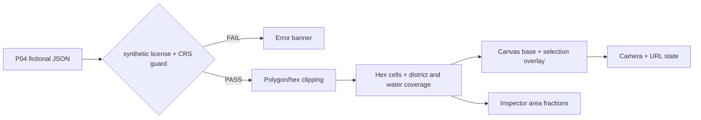

# ShanghaiCiv P07｜Canvas 2D 合成地图交互原型

> **工程状态**：代码实现，G5a 合成原型验收以 CI 实际结果为准。  
> **数据声明**：**完全虚构 GIS 测试场景**。不是上海真实行政地图，不涉及官方统计和地图瓦片。  
> **独立阻塞**：P01/G1 真实地理数据授权与地图发布审核依旧 BLOCKED。

## 1. 一条命令运行

从仓库根目录执行：

```bash
python -m http.server 8765 --bind 127.0.0.1
```

浏览器打开 http://127.0.0.1:8765/web/dev/synthetic-map.html 。

不要直接使用 `file://`：浏览器可能阻止本地 JSON `fetch`。网页不访问地图服务器或使用外部字体，加载的唯一地理数据是仓库内人工合成的 `tests/fixtures/synthetic/synthetic_gis_scene.json`。

## 2. 交互与产品功能

| 区域 | 能力 |
|---|---|
| 左栏 | 显著的 SYNTHETIC 警告、虚构区域聚焦、重置/复制视角、4个图层开关、原始 fixture 链接 |
| 中间 Canvas | hex 地图、陆/水/未分类颜色、虚构行政区界、悬停/选择、缩放和平移、虚构距离比例尺、性能状态 |
| 右侧 Inspector | Cell ID、陆地/水域/未分类比例、区属覆盖比例、混合边缘格标签与来源 |
| 移动端 | 响应式布局、单指平移、双指缩放、触摸选择和缩放按钮 |

交互契约：
- 鼠标滚轮缩放围绕指针位置保持锚点；按住鼠标拖拽平移，点击选中 hex；
- Canvas 获得键盘焦点后，方向键平移、加减号缩放、Enter 选择地图中心格；
- 使用两个 Canvas：基础图层仅在相机/图层改变时重绘，hover 与选择只更新 overlay；
- URL hash 持久化相机 x/y/zoom、选中 cell 和启用图层，支持刷新恢复；
- 原型从 P04 JSON 计算 56 格的陆/水/区属覆盖率，不从真实区级人口/GDP 推导伪精度；
- 无法加载 JSON 时明确显示失败，而不是出现假数据或空白“正常地图”。

## 3. 技术文件

| 文件 | 职责 |
|---|---|
| `web/dev/synthetic-map.html` | 可访问的静态页面 |
| `web/css/synthetic-map.css` | 深色地理探索 UI，移动端样式，无 CDN |
| `web/js/app/synthetic-map.mjs` | 事件、源校验、状态、URL、Inspector |
| `web/js/camera.mjs` | 纯数学相机/缩放/平移/屏幕坐标与世界坐标 |
| `web/js/synthetic-spatial.mjs` | P04 几何裁剪 JavaScript 镜像与逐格覆盖 |
| `web/js/render/synthetic-canvas.mjs` | Base Canvas、动态 Overlay、视窗裁剪 |
| `tests/js/synthetic-map.test.mjs` | Node 单测、相机不变量、Python↔JS 覆盖率一致性 |
| `tests/js/synthetic-map.e2e.mjs` | Chromium 真实浏览器 E2E，桌面及移动端 |
| `.github/workflows/p07-synthetic-canvas.yml` | CI 自动化、截图 artifact 与发布门禁 |

Source graph：



运行可复核的 Python↔JS 叠合一致性检查：

```bash
python -m pipeline spatial --workspace .p07-work
python -m pipeline spatial-check --workspace .p07-work
node --test tests/js/*.test.mjs
```

无 P04 生成文件时，Node 的跨语言对照用例会显式 skip；一般单元用例仍执行。

## 4. 浏览器验收

| ID | 测试旅程 |
|---|---|
| P07-E01 | 页面加载并显著声明“虚构地图”，输出 56 格 |
| P07-E02 | 单元点选显示百分比与区域交集 |
| P07-E03 | 放大、缩小且保留当前选区 |
| P07-E04 | 拖拽、键盘移动后 camera/URL 发生预期变化 |
| P07-E05 | 切换格网图层，刷新后图层和选区复原 |
| P07-E06 | 聚焦虚构乙区，重置视角后清除选区 |
| P07-E07 | 请求源失败，显示 error banner 和状态 |
| P07-E08 | 390 px 移动端触摸选择、缩放控件与来源警告可见 |
| P07-E09 | Python 与浏览器 56 格 land/water/outside/partial 一致 |
| P07-E10 | 恶意或错误 CRS/许可数据被拒绝，任何真实地图数据均不在 web/data 发布 |

浏览器 E2E 使用固定版本的 Playwright Chromium 测试，保存桌面/移动端截图至 GitHub Actions artifact。测试包括真实 Canvas 用户交互，不只是 DOM 静态检查。

本地完整浏览器测试：

```bash
npm install --no-save --no-package-lock playwright@1.56.1
npx playwright install chromium
# 一个终端启动 http.server，再在另一终端运行：
node tests/js/synthetic-map.e2e.mjs
```

## 5. 性能与正式地图阻塞

- P07 演示使用**56 个合成 hex**；不声称完成生产地图 45/30 FPS 性能目标。
- CSS 不引入第三方字体或地图 SDK，无需 API Key；Chrome 动态渲染用 requestAnimationFrame 合并。
- `SYNTHETIC_LOCAL_METERS` 不是真实投影；它仅满足纯数学坐标验证。
- 区级统计没有放到 hex 中，单元 Inspector 仅展示几何面积比例。
- GitHub Pages 的真实地图发布门禁仍为 **BLOCKED**；这一开发页不是已获审图号的地图产品。

待合成 UI CI 达到 G5a，后续可以在授权核实前继续构建 **P08 合成专题与 Almanac UI**；真实地理边界和区级统计来源必须单独履行 P01 条款与审图核查。